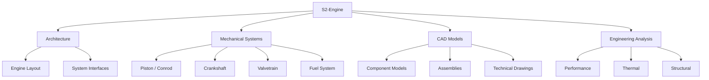
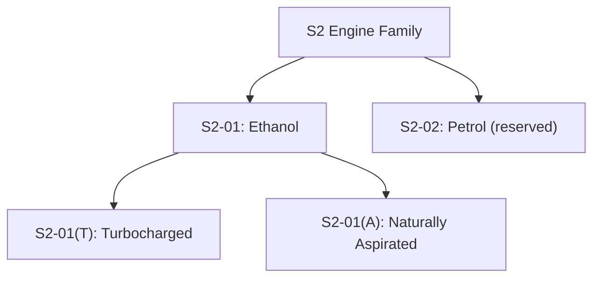
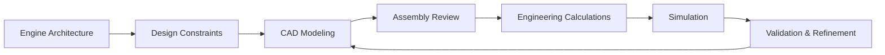
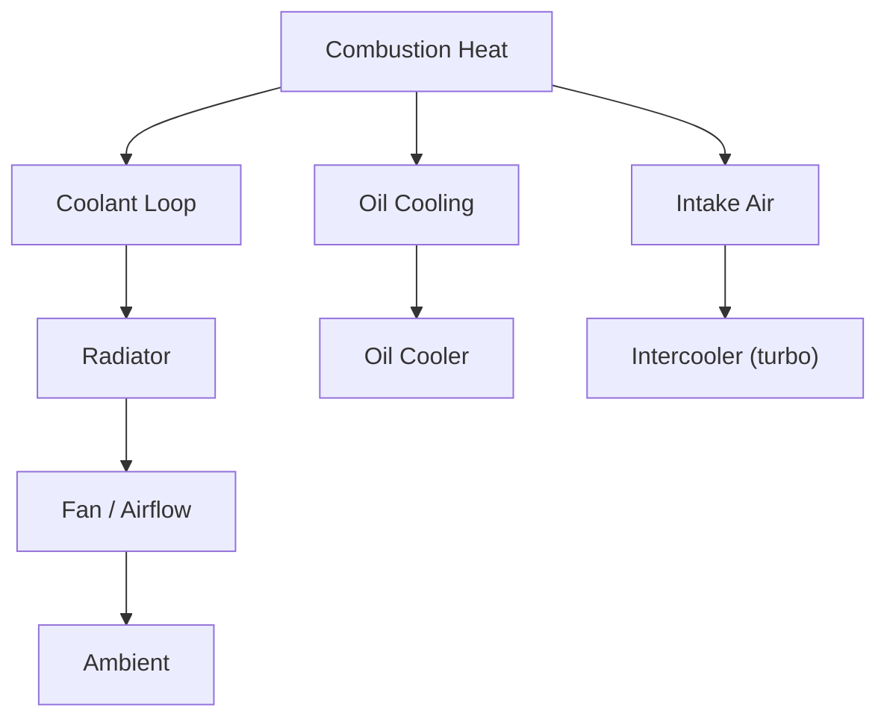
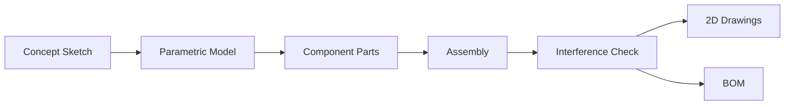

# S2-Engine

**An independent engine design and engineering project.**

S2-Engine is dedicated to the conceptual design, CAD modeling, and engineering analysis of an internal combustion engine. The project focuses on mechanical architecture, component systems, performance constraints, thermal management, and detailed 3D assemblies.

> Status: **conceptual development stage.** Specifications, CAD models, and performance targets are documented as they are established. Estimated, calculated, simulated, and experimentally measured results are always distinguished.

---

## Table of Contents

- [Engineering Overview](#engineering-overview)
- [Project Objectives](#project-objectives)
- [Engine Family](#engine-family)
- [Planned Repository Structure](#planned-repository-structure)
- [Development Workflow](#development-workflow)
- [Thermal Management](#thermal-management)
- [CAD Pipeline](#cad-pipeline)
- [Engineering Constraints (initial targets)](#engineering-constraints-initial-targets)
- [Materials & Components](#materials--components)
- [Calculations & Simulation](#calculations--simulation)
- [Development Status](#development-status)
- [Engineering Principles](#engineering-principles)
- [License](#license)

---

## Engineering Overview



<details>
<summary>Mermaid source</summary>



</details>

The engine is decomposed into four top-level domains — **Architecture**, **Mechanical Systems**, **CAD Models**, and **Engineering Analysis** — each with its own components and review gates.

---

## Project Objectives

- **Engine Architecture:** Establish the mechanical layout, component arrangement, and system interfaces.
- **CAD Development:** Create detailed 3D component models, assemblies, and technical drawings.
- **Performance Constraints:** Define and analyze power, torque, pressure, and operating limits.
- **Thermal Management:** Investigate cooling requirements, heat transfer, and temperature constraints.
- **Materials & Components:** Document material choices, component specifications, and design considerations.
- **Engineering Analysis:** Develop calculations and simulations to evaluate design decisions.

---

## Engine Family



<details>
<summary>Mermaid source</summary>



</details>

- **S2-01** — ethanol-fueled internal combustion engine concept. Initial focus of the project.
  - **S2-01(T)** — turbocharged variant (planned; feasibility TBD).
  - **S2-01(A)** — naturally aspirated variant (planned; feasibility TBD).
- **S2-02** — petrol-fueled concept, reserved for potential future development.

Turbocharged and naturally aspirated configurations are planned variants whose specifications and feasibility remain to be evaluated.

---

## Planned Repository Structure

```text
S2-Engine/
├── CAD/
│   ├── Components/
│   ├── Assemblies/
│   └── Drawings/
├── Architecture/
├── Mechanical-Systems/
├── Engineering-Constraints/
├── Materials/
├── Calculations/
├── Simulation/
├── Specifications/
├── diagrams/            # rendered figures (SVG)
├── LICENSE
└── README.md
```

The directory structure will evolve as the design develops.

---

## Development Workflow


<details>
<summary>Mermaid source</summary>



</details>

Each stage identifies design issues and guides subsequent revisions. Simulation results are **not** treated as experimental proof.

---

## Thermal Management



<details>
<summary>Mermaid source</summary>



</details>

Cooling paths are split by heat source: coolant loop → radiator → fan → ambient; oil → oil cooler; intake air → intercooler (turbo variant only). Heat-rejection targets and coolant flow rates are to be established during the constraints phase.

---

## CAD Pipeline



<details>
<summary>Mermaid source</summary>



</details>

All parts are modeled parametrically so dimensions can be driven by the engineering constraints. Assemblies undergo interference checks before drawings and BOM generation.

---

## Engineering Constraints (initial targets)

Values below are **placeholders / to-be-defined**. They will be replaced with calculated or simulated values as the design matures.

| Parameter | Target | Status |
|---|---|---|
| Fuel | Ethanol (E100) | defined |
| Displacement | TBD | TBD |
| Bore × Stroke | TBD | TBD |
| Compression ratio | TBD | TBD |
| Max power | TBD | TBD |
| Max torque | TBD | TBD |
| Redline | TBD | TBD |
| Cooling | Liquid-cooled | defined |
| Aspiration | Turbocharged / NA | planned variants |

---

## Materials & Components

Material choices and component specifications will be documented per part under `Materials/` and `Specifications/`. Initial considerations:

- **Block / head:** cast aluminum or cast iron (trade-off: mass vs. thermal conductivity and cost).
- **Crankshaft:** forged steel.
- **Pistons:** forged aluminum with steel ring carriers.
- **Gaskets / seals:** ethanol-compatible elastomers.

---

## Calculations & Simulation

- Hand calculations and spreadsheets live under `Calculations/`.
- FEA / thermal / CFD studies live under `Simulation/`.
- Every result must be tagged as **estimated / calculated / simulated / measured** and reference its assumptions.

---

## Development Status

S2-Engine is in the conceptual development stage. Engine specifications, CAD models, component designs, and performance targets will be documented as they are established.

Estimated, calculated, simulated, and experimentally measured results will be distinguished clearly.

---

## Engineering Principles

- Document assumptions and design constraints.
- Prioritize mechanical consistency and component compatibility.
- Evaluate performance alongside thermal, structural, and material limits.
- Keep design revisions and technical decisions traceable.
- Validate engineering claims against appropriate evidence.

---

## License

See the [`LICENSE`](LICENSE) file for the applicable licensing terms.

---

*Conceptualize. Design. Analyze. Validate.*